# 🧪 Slime Rice — Arch Linux Desktop & Modular Narrative Ecosystem

A cohesive, highly-modular desktop environment and dynamic narrative engine built on **AwesomeWM 4.3**, **Picom (GLX + dual-kawase)**, **Alacritty / Kitty / LXTerminal**, **Tmux**, **Starship**, **Rofi**, **Neovim**, and **Python Tkinter dropdown pads**, designed specifically for Arch Linux on the ASUS TUF FX505DY.

Originally conceived as a standalone radioactive-swamp biohazard rice, **Slime** has evolved into an expansive **38-theme ecosystem**. Each theme acts as a complete, hot-swappable desktop profile with dedicated color palettes, Cairo procedural bar shapes, companion mascots, ASCII sysinfo banners, and terminal configurations.


---

## 🚀 How the Project Has Changed

Slime Rice has undergone extensive architectural refactoring and expansion, transitioning from a single static theme into a resilient, automated, multi-theme desktop workstation:

```
┌───────────────────────────────────────────────────────────────────────────────────┐
│                           THE SLIME RICE ARCHITECTURE                             │
│                                                                                   │
│  ┌──────────────────────┐   Super+o   ┌────────────────────────────────────────┐  │
│  │   bin/theme-toggle   │ ──────────> │   38 Modular Theme Profiles            │  │
│  └──────────────────────┘             │   (origin → slime → foundry → speed)   │  │
│            │                          └────────────────────────────────────────┘  │
│            │ hot-swaps synchronized configs across 15+ desktop components         │
│            ▼                                                                      │
│  ┌─────────────────────────────────────────────────────────────────────────────┐  │
│  │ • AwesomeWM: Dynamic palette, Cairo vector geometry & companion widgets     │  │
│  │ • Terminals: Alacritty (strict 7pt / 6.5pt baseline), Kitty, LXTerminal     │  │
│  │ • Multiplexer: Tmux statusline and border highlights                        │  │
│  │ • Shell: Starship 2-line prompt with explicit exit code status reporting    │  │
│  │ • Editor: Neovim colorschemes with dynamic focus-tracking reload            │  │
│  │ • Compositor & Launcher: Picom GLX dual-kawase blur & Rofi modal styling    │  │
│  │ • System Monitor: Btop++ custom theme palettes                              │  │
│  │ • Python GUIs: 11 Tkinter dropdown pads with centralized theme engine       │  │
│  │ • Companion Consoles: Fastfetch ANSI art, custom fetchers, mascot shells    │  │
│  └─────────────────────────────────────────────────────────────────────────────┘  │
└───────────────────────────────────────────────────────────────────────────────────┘
```

### Key Architectural Upgrades

1. **38 Hot-Swappable Desktop Themes**:
   - Full narrative acts (Origin, Lab, Slime, Cyber, Space) alongside 33 standalone aesthetic worlds (Foundry, Halfpipe, Speedster, Satanic Panic, Vaporwave Schizoid, Chomp, and more).
   - Seamless switching via `theme-toggle` or `Super + o` (forward) and `Super + Shift + o` (random) without restarting desktop applications.

2. **Deconstructed Bar UI & Companion Factory**:
   - Refactored [`config/awesome/ui/bar.lua`](config/awesome/ui/bar.lua) using a declarative companion factory pattern.
   - Eliminated over 830 lines of duplicate conditionals and boilerplate while standardizing telemetry pills, taglists, and companion mascot launchers.

3. **Universal Invisible-Edge Bar Autohide**:
   - Every theme's top wibar starts hidden to maximize screen real estate.
   - A 2-pixel invisible edge strip along the top of each display reveals the bar on pointer hover.
   - The bar floats as an overlay above windows without displacing or resizing tiled clients, automatically retracting ~0.5s after pointer departure.

4. **Dynamic Monospace Font Chooser (`pads/font_pad.py`)**:
   - An interactive Tkinter desktop tool (`Super + Shift + f`) that scans installed monospace fonts, previews them against live desktop palettes, and retunes AwesomeWM, Alacritty, Kitty, LXTerminal, and Rofi configurations across all 38 themes.

5. **Strict 15-Component System-Wide Parity**:
   - Every theme strictly configures AwesomeWM, Alacritty, Kitty, LXTerminal, Tmux, Rofi, Picom, Starship, Btop, Neovim, Python Tkinter pads, fastfetch banners, companion CLI fetchers, and terminal pads.
   - Neovim dynamically tracks focus and automatically reloads the active colorscheme when returning to the editor.

6. **Starship Status Error & Module Hardening**:
   - All 39 Starship configurations enforce `[status] disabled = false` with themed status badges, ensuring command errors and non-zero exit codes are never silently hidden.

7. **Security Hardening & Safe Serialization**:
   - Hardened [`bin/sorted`](bin/sorted) (automatic downloads organizer) by replacing unsafe Lua code evaluation with safe JSON serialization for desktop notifications.
   - Relativized symlinks across `bin/` and integrated `config/fastfetch/` into backup routines.

8. **Automated Verification & Parity Test Suite**:
   - 31 automated unit tests ([`tests/test_theme_parity.py`](tests/test_theme_parity.py), [`tests/test_bar_autohide.py`](tests/test_bar_autohide.py), etc.) execute in isolated sandboxed environments to verify font sizing baselines, shortcut uniqueness, Neovim highlights, and configuration deployments.

---

## 🎭 Available Desktop Themes (38 Themes)

All 38 themes can be activated directly using `theme-toggle <name>` or cycled sequentially with `Super + o`.

### Quick Reference Catalog

| # | Theme Slug | Display Name | Preview | Aesthetic Concept & Highlights | Default Typography | Companion Shell / Doc |
| -: | :--- | :--- | :---: | :--- | :--- | :--- |
| **01** | `origin` | The Specimen Origin | [📸 Screenshot](docs/screenshots/origin.png) | Act 0: Amber glow, dark containment specimen log | `MonaspiceRn Nerd Font` | `origin-fetch` |
| **02** | `lab` | Laboratory White | [📸 Screenshot](docs/screenshots/lab.png) | Act I: Clean-room sterile white, high-contrast darks | `ShureTechMono Nerd Font` | `lab-fetch` |
| **03** | `slime` | Biohazard Slime | [📸 Screenshot](docs/screenshots/slime.png) | Act II: Radioactive toxic green, murky swamp darks | `OpenDyslexic Nerd Font` | `slime-fetch` • [Guide](docs/slime-rice.md) |
| **04** | `cyber` | Cyberpunk Future | [📸 Screenshot](docs/screenshots/cyber.png) | Act III: High-voltage neon cyan, magenta, deep violet | `ZedMono Nerd Font` | `cyber-fetch` |
| **05** | `space` | Orbital Containment | [📸 Screenshot](docs/screenshots/space.png) | Act IV: Deep space slate navy, stellar amber telemetry | `SpaceMono Nerd Font` | `space-fetch` |
| **06** | `shred` | The Shredder | [📸 Screenshot](docs/screenshots/shred.png) | High-RPM mechanical silver, dark steel tachometer | `JetBrainsMono Nerd Font` | `theme-console` |
| **07** | `chomp` | Chomp the Haxor | [📸 Screenshot](docs/screenshots/chomp.png) | CRT terminal green, cyber-swamp hacker muskrat | `BigBlueTermPlus Nerd Font` | `chomp-pad` |
| **08** | `red` | Doom (Rip & Tear) | [📸 Screenshot](docs/screenshots/red.png) | Industrial steel, hellscape crimson, BFG combat HUD | `GohuFont 11 Nerd Font` | `theme-console` |
| **09** | `windbreaker` | 90s Neon Windbreaker | [📸 Screenshot](docs/screenshots/windbreaker.png) | Vibrant nylon teal, hot magenta, nostalgic geometric pop | `ComicShannsMono Nerd Font` | `theme-console` |
| **10** | `clay` | Clay Tablet | [📸 Screenshot](docs/screenshots/clay.png) | Ancient Mesopotamian cuneiform, silt, terracotta umber | `IosevkaTermSlab Nerd Font` | `theme-console` |
| **11** | `void` | Abyssal Void | — | Obsidian singularity, event horizon violet, teal lensing | `JetBrainsMono Nerd Font` | `theme-console` |
| **12** | `gill` | Baron von Gill | [📸 Screenshot](docs/screenshots/gill.png) | Subterranean grotto, bioluminescent cyan creature | `JetBrainsMono Nerd Font` | `gill-pad` |
| **13** | `mothgomery` | Mothgomery | [📸 Screenshot](docs/screenshots/mothgomery.png) | Warm aged brass, parchment, lamplit inventor workshop | `JetBrainsMono Nerd Font` | `mothgomery-pad` • [Guide](docs/mothgomery.md) |
| **14** | `rable` | Miss Rable | [📸 Screenshot](docs/screenshots/rable.png) | Neon street punk alleyway, hot pink graffiti | `JetBrainsMono Nerd Font` | `rable-pad` |
| **15** | `tov` | Molly Tov | — | Street riot flares, soot smoke, blazing anarchist orange | `JetBrainsMono Nerd Font` | `tov-pad` |
| **16** | `dino` | Dino Might | [📸 Screenshot](docs/screenshots/dino.png) | Heavyweight radioactive reptilian brawler, lime & asphalt | `JetBrainsMono Nerd Font` | `dino-pad` |
| **17** | `crust` | Crust | [📸 Screenshot](docs/screenshots/crust.png) | Grimy crustpunk drifter, alleyway dumpster gold | `JetBrainsMono Nerd Font` | `crust-pad` |
| **18** | `tunes` | Looney Tunes | [📸 Screenshot](docs/screenshots/tunes.png) | Saturday morning animation, Acme scarlet, vintage cartoon | `ComicShannsMono Nerd Font` | `tunes-pad` |
| **19** | `mystery` | Mystery Machine | [📸 Screenshot](docs/screenshots/mystery.png) | Flower-power van psych turquoise, groovy orange & lime | `ComicShannsMono Nerd Font` | `mystery-pad` |
| **20** | `darkwing` | Darkwing Duck | [📸 Screenshot](docs/screenshots/darkwing.png) | St. Canard vigilante noir, twilight purple, cyan cape | `ComicShannsMono Nerd Font` | `darkwing-pad` |
| **21** | `tmnt` | Ninja Turtles | [📸 Screenshot](docs/screenshots/tmnt.png) | Sewer green, mutagen ooze, pizza cheese, bandana accents | `ComicShannsMono Nerd Font` | `tmnt-pad` |
| **22** | `muppet` | Muppet Babies | [📸 Screenshot](docs/screenshots/muppet.png) | Pastel vaporwave daydream, nursery lavender, soft rose | `ComicShannsMono Nerd Font` | `muppet-pad` |
| **23** | `jon` | I'm Sorry Jon | [📸 Screenshot](docs/screenshots/jon.png) | Eldritch lasagna feline horror, void meat, dark ochre | `ComicShannsMono Nerd Font` | `jon-pad` |
| **24** | `bake` | Wake & Bake (420) | — | Dank herbal pine green, resin amber, chill smoke | `ComicShannsMono Nerd Font` | `bake-pad` |
| **25** | `foundry` | Foundry | [📸 Screenshot](docs/screenshots/foundry.png) | Victorian cast-iron, aged copper, rotating brass gears | `IosevkaTermSlab Nerd Font` | [Guide](docs/foundry.md) |
| **26** | `sketchbook` | Sketchbook | [🔍 Bar](docs/previews/sketchbook-bar.png) | Light watercolor paper, graphite pencil, clipped corners | `JetBrainsMono Nerd Font` | [Guide](docs/sketchbook.md) |
| **27** | `jaws` | Grindhouse JAWS | [📸 Screenshot](docs/screenshots/jaws.png) | Deep ocean abyss, vintage poster cream, chum red | `JetBrainsMono Nerd Font` | [Guide](docs/jaws.md) |
| **28** | `bamboo-corsair` | The Bamboo Corsair | — | Spectral pirate sails, bamboo emerald, ethereal mist | `JetBrainsMono Nerd Font` | [Guide](docs/bamboo-corsair.md) |
| **29** | `eeyore` | Eeyore — Watercolor Sky | [📸 Screenshot](docs/screenshots/eeyore.png) | Cloud-white floating bar, sky blue, sage, muted plum | `Noto Sans` | [Guide](docs/eeyore.md) |
| **30** | `halfpipe` | Halfpipe | [🔍 Bar](docs/previews/halfpipe-bar.png) | Concrete skate ramp silhouette, quarterpipes, deck icons | `JetBrainsMono Nerd Font` | [Guide](docs/halfpipe.md) |
| **31** | `punk-show` | Punk Show! | [📸 Screenshot](docs/screenshots/punk-show.png) | Battered audio console, channel buttons, LED meters | `JetBrainsMono Nerd Font` | [Guide](docs/punk-show.md) |
| **32** | `sugar-rush` | Sugar Rush | [📸 Screenshot](docs/screenshots/sugar-rush.png) | Candy chainsaw bar, lavender teeth, sprinkle telemetry | `Noto Sans` | [Guide](docs/sugar-rush.md) |
| **33** | `crayon-chomp` | Crayon Chomp | [📸 Screenshot](docs/screenshots/crayon-chomp.png) | Torn construction paper, broken crayon marks, pond muskrat | `Noto Sans` | [Guide](docs/crayon-chomp.md) |
| **34** | `satanic-panic` | Satanic Panic! | [🔍 Bar](docs/previews/satanic-panic-bar.png) | Tarnished occult knife bar, dried oxblood, VHS ritual | `JetBrainsMono Nerd Font` | [Guide](docs/satanic-panic.md) |
| **35** | `vaporwave-schizoid` | Vaporwave Schizoid | [📸 Screenshot](docs/screenshots/vaporwave-schizoid.png) | Wireframe pyramids, holographic bar, VHS scanlines | `JetBrainsMono Nerd Font` | [Guide](docs/vaporwave-schizoid.md) |
| **36** | `moonlit-well` | The Well | [📸 Screenshot](docs/screenshots/moonlit-well.png) | Eldritch stone well, creeping tentacles, spectral teal | `JetBrainsMono Nerd Font` | [Guide](docs/moonlit-well.md) |
| **37** | `scp-facility` | SCP Facility | [📸 Screenshot](docs/screenshots/scp-facility.png) | Gunmetal containment dashboard, surveillance feeds, amber | `JetBrainsMono Nerd Font` | [Guide](docs/scp-facility.md) |
| **38** | `speedster` | Speedster and Crew | [📸 Screenshot](docs/screenshots/speedster.png) | Cozy vintage cartoon clubhouse, espresso, amber, violet | `ComicShannsMono Nerd Font` | `speedster-pad` • [Guide](docs/speedster.md) |

---

### Thematic Groupings

#### 🧪 1. The Core Narrative Acts (The Lab Chronicles)
- **Act 0: The Specimen Origin (`origin`)**: Deep amber and containment-cell green charting the initial discovery.
- **Act I: Laboratory White (`lab`)**: Clean sterile laboratory white and surgical black before containment breach.
- **Act II: Biohazard Slime (`slime`)**: The flagship toxic radioactive green swamp environment.
- **Act III: Cyberpunk Future (`cyber`)**: High-voltage neon cyan and magenta grid link.
- **Act IV: Orbital Containment (`space`)**: Deep navy cosmos telemetry aboard an orbital research platform.

| **Act 0: Origin (`origin`)** | **Act I: Laboratory White (`lab`)** |
| :---: | :---: |
| [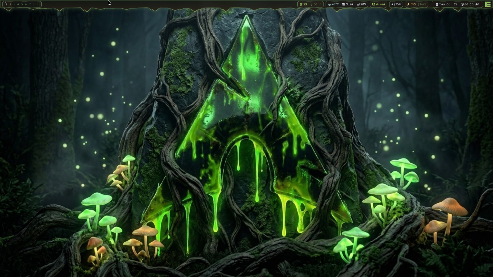](docs/screenshots/origin.png) | [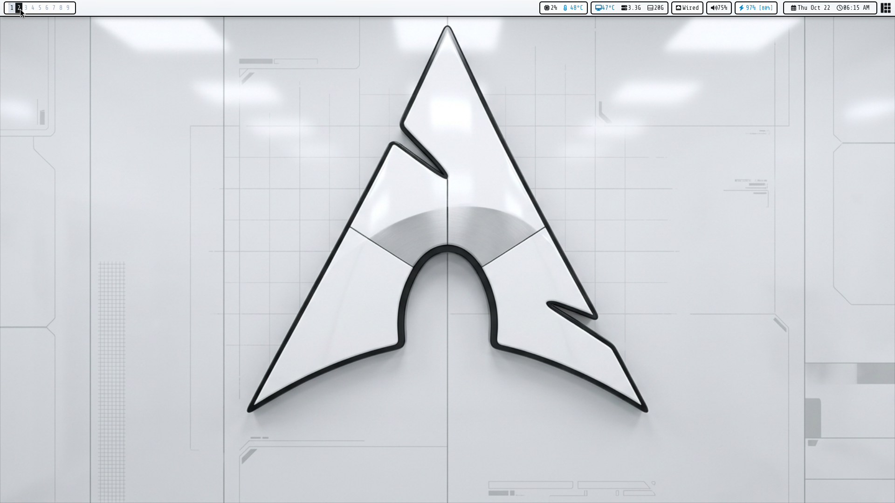](docs/screenshots/lab.png) |

| **Act II: Biohazard Slime (`slime`)** | **Act III: Cyberpunk Future (`cyber`)** |
| :---: | :---: |
| [](docs/screenshots/slime.png) | [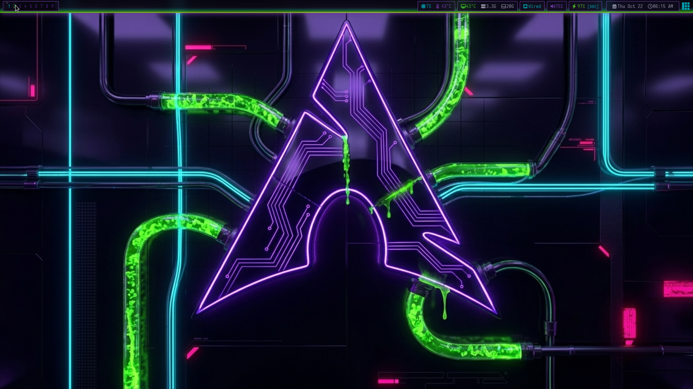](docs/screenshots/cyber.png) |

| **Act IV: Orbital Containment (`space`)** | |
| :---: | :---: |
| [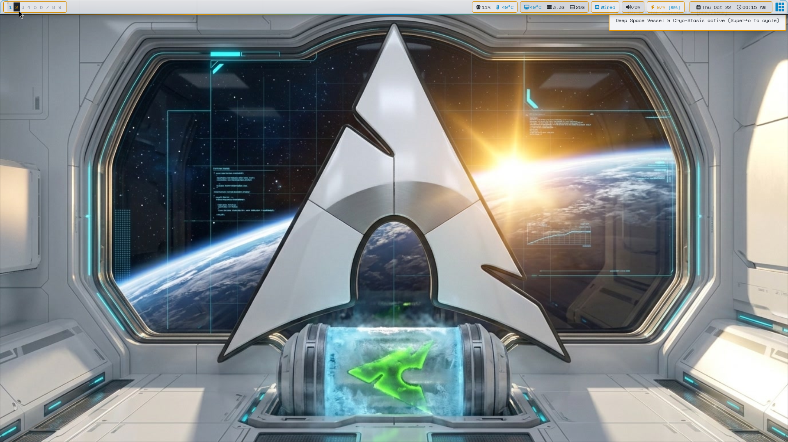](docs/screenshots/space.png) | |

#### ⚙️ 2. Industrial, Cyber & Mechanical
- **The Shredder (`shred`)**: Chrome-and-steel automotive tachometer aesthetics.
- **Chomp the Haxor (`chomp`)**: Green-phosphor terminal CRT style featuring the pond-side hacker mascot.
- **Foundry (`foundry`)**: Victorian steam-engine room with rotating brass gear assemblies and riveted iron sills.
- **SCP Facility (`scp-facility`)**: Reinforced containment dashboard with CCTV-style workspace feeds and alert status.
- **Clay Tablet (`clay`)**: Terracotta silt and Mesopotamian cuneiform styling.
- **Abyssal Void (`void`)**: Pure black singularity with teal event-horizon lensing.

| **The Shredder (`shred`)** | **Chomp the Haxor (`chomp`)** |
| :---: | :---: |
| [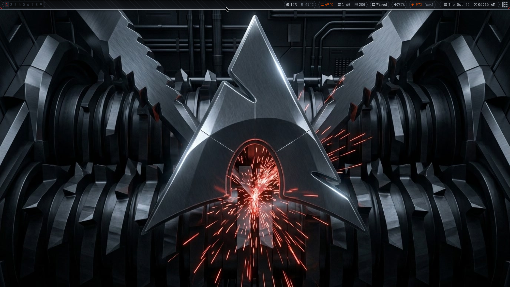](docs/screenshots/shred.png) | [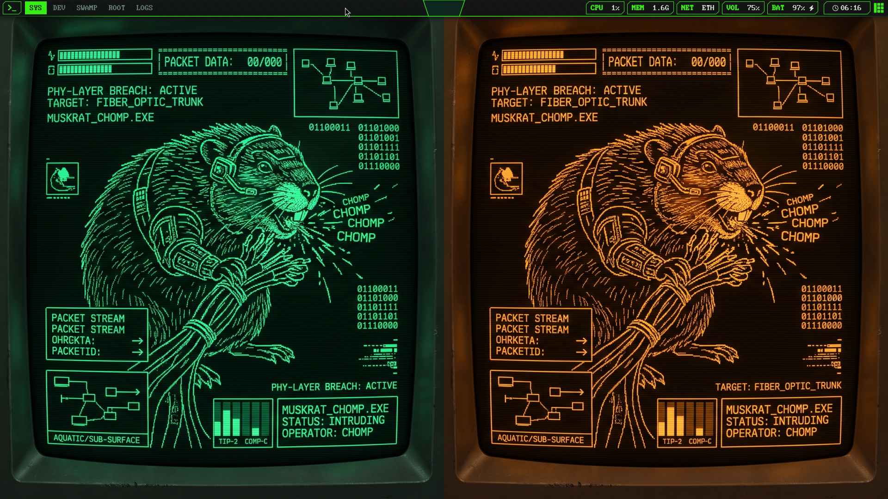](docs/screenshots/chomp.png) |

| **Foundry (`foundry`)** | **SCP Facility (`scp-facility`)** |
| :---: | :---: |
| [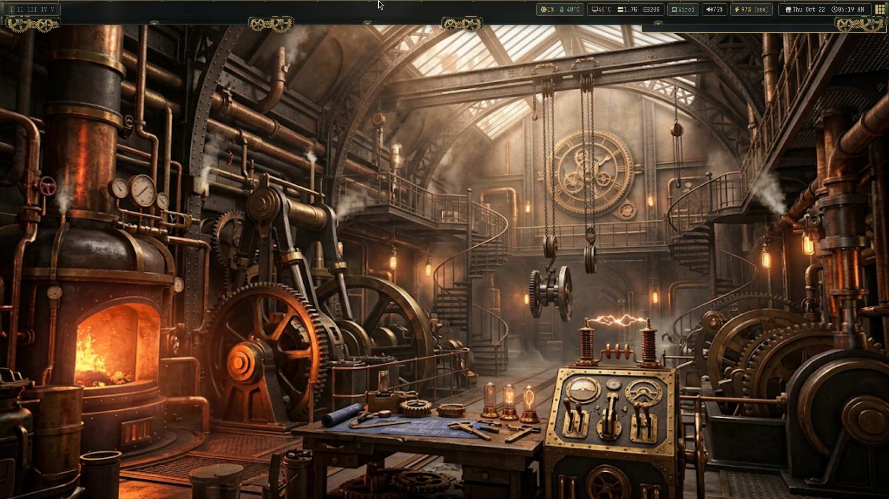](docs/screenshots/foundry.png) | [](docs/screenshots/scp-facility.png) |

| **Clay Tablet (`clay`)** | **Abyssal Void (`void`)** |
| :---: | :---: |
| [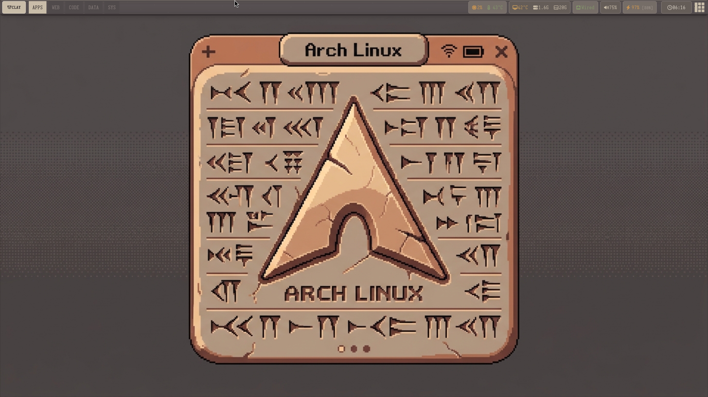](docs/screenshots/clay.png) | *(Desktop screenshot coming soon)* |

#### 📺 3. Retro Cartoon, Gaming & Pop Culture
- **Speedster and Crew (`speedster`)**: Warm espresso clubhouse, radiant amber headlights, and cozy dusk lighting.
- **Doom (`red`)**: Classic id Software 1993 hellscape steel and crimson BFG combat HUD.
- **90s Neon Windbreaker (`windbreaker`)**: Retro nylon pastel pop nostalgia.
- **Looney Tunes (`tunes`)**: Acme red bullseye, vintage parchment, and classic cartoon humor.
- **Mystery Machine (`mystery`)**: Groovy 1969 psychedelic van floral lime and turquoise.
- **Darkwing Duck (`darkwing`)**: St. Canard superhero noir with purple fedora and cyan highlights.
- **Ninja Turtles (`tmnt`)**: Sewer green, mutagen canister ooze, and pizza slice telemetry.
- **Muppet Babies (`muppet`)**: Dreamy nursery pastel vaporwave.
- **Wake & Bake (`bake`)**: Dank resin gold, pine green, and chill smoke.

| **Speedster and Crew (`speedster`)** | **Doom: Rip & Tear (`red`)** |
| :---: | :---: |
| [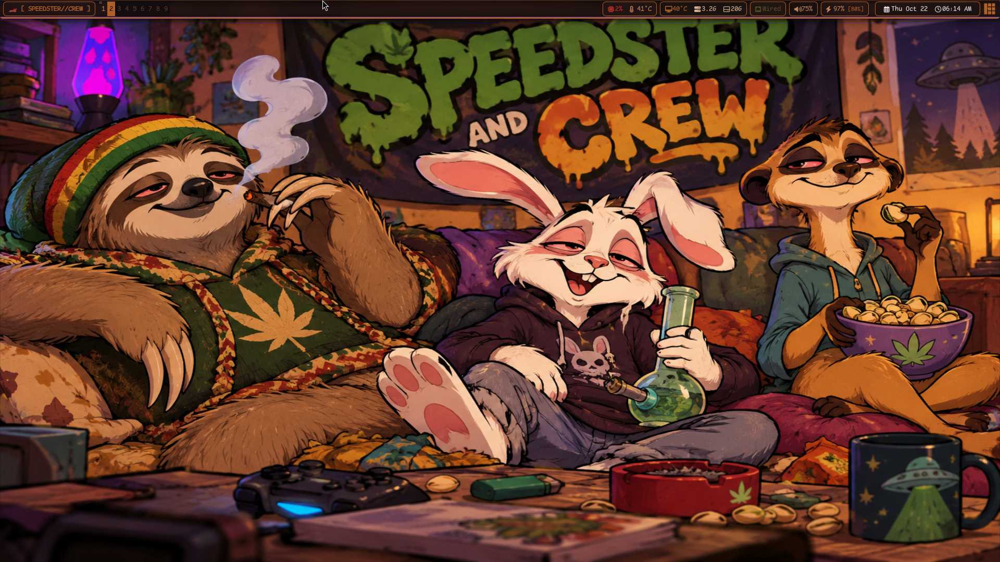](docs/screenshots/speedster.png) | [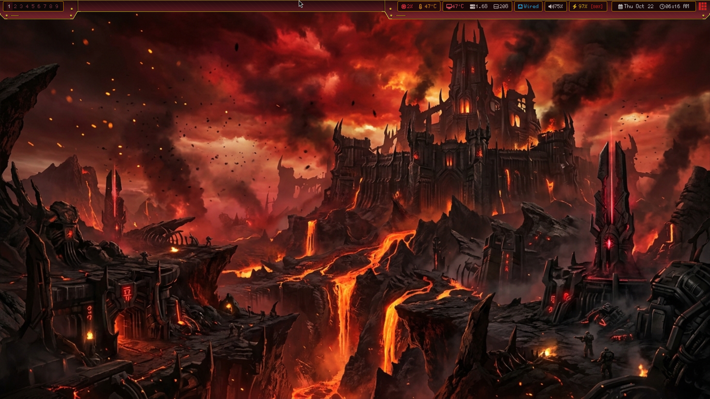](docs/screenshots/red.png) |

| **90s Neon Windbreaker (`windbreaker`)** | **Looney Tunes (`tunes`)** |
| :---: | :---: |
| [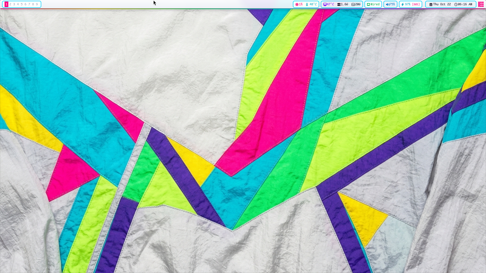](docs/screenshots/windbreaker.png) | [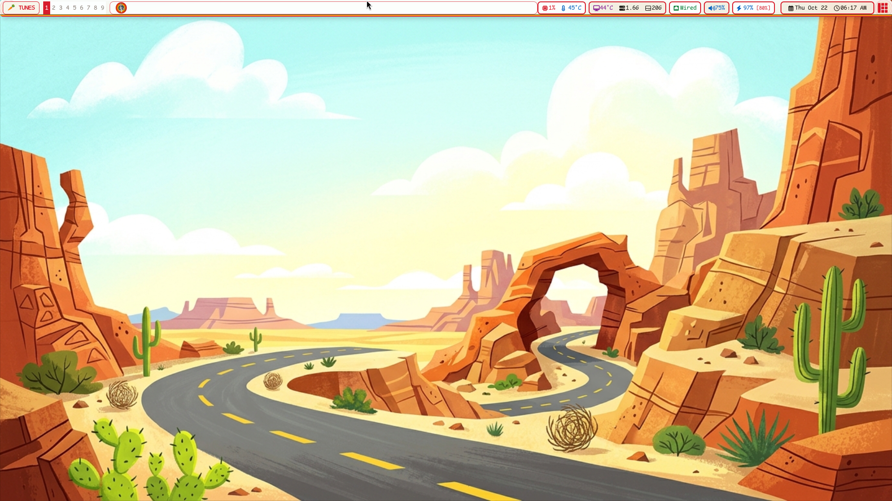](docs/screenshots/tunes.png) |

| **Mystery Machine (`mystery`)** | **Darkwing Duck (`darkwing`)** |
| :---: | :---: |
| [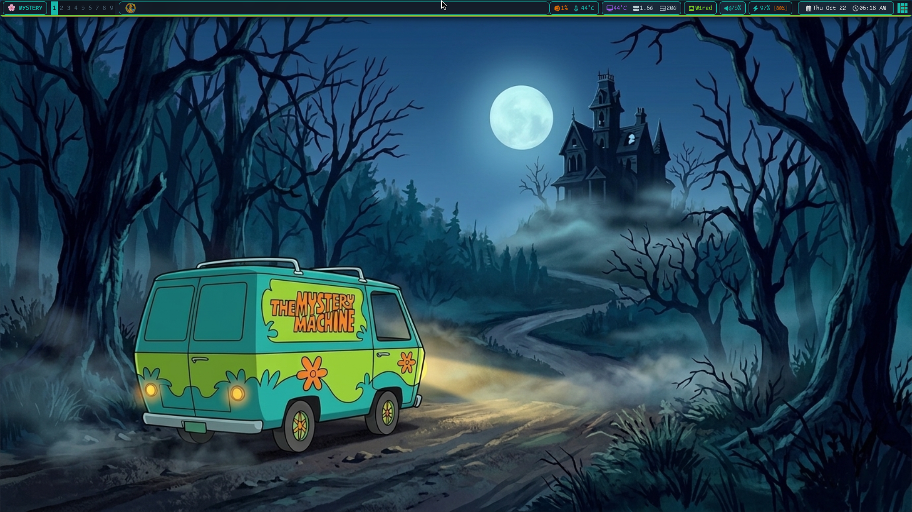](docs/screenshots/mystery.png) | [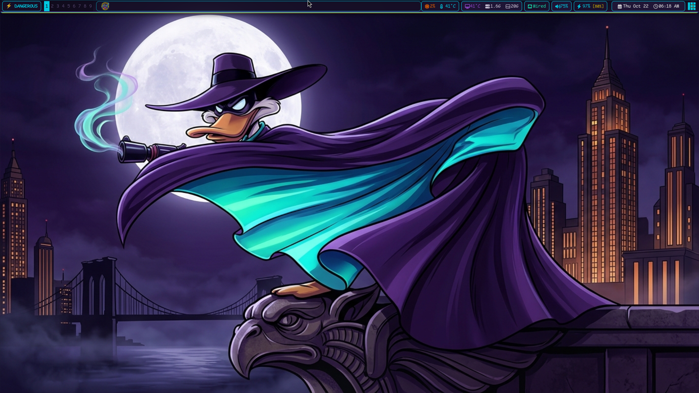](docs/screenshots/darkwing.png) |

| **Ninja Turtles (`tmnt`)** | **Muppet Babies (`muppet`)** |
| :---: | :---: |
| [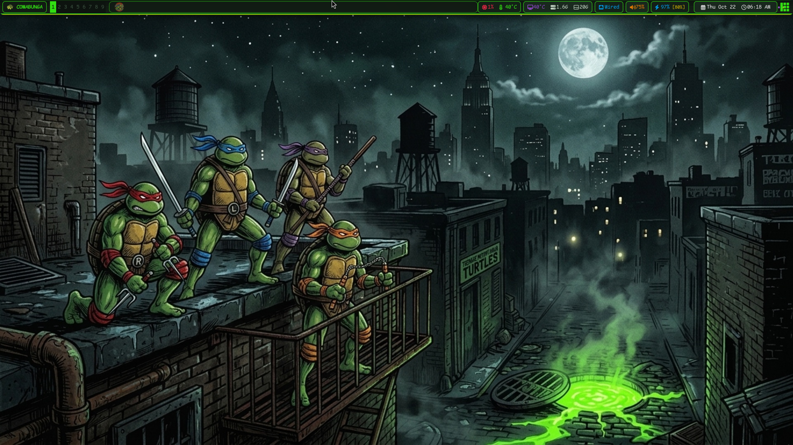](docs/screenshots/tmnt.png) | [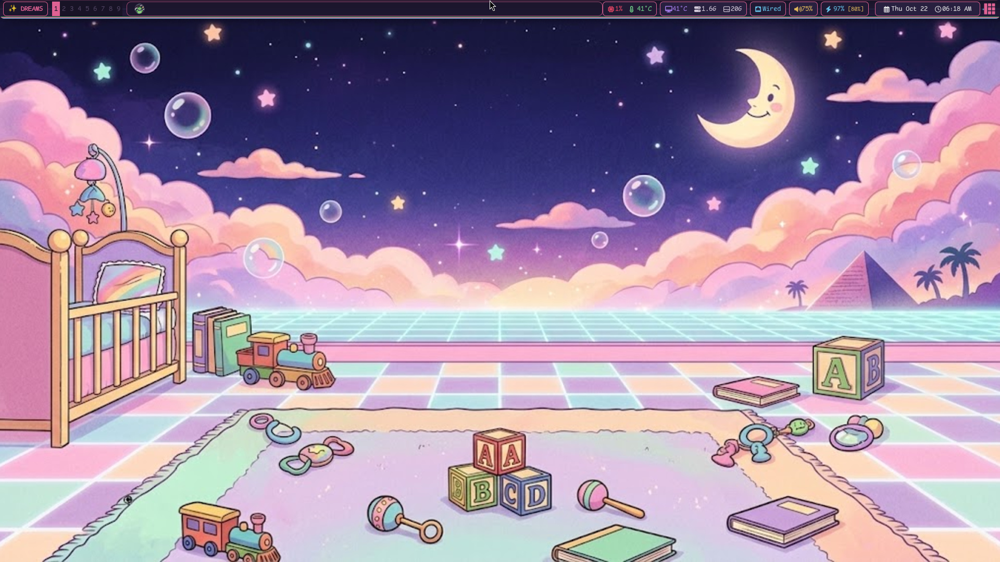](docs/screenshots/muppet.png) |

- **Wake & Bake (`bake`)**: *Dank herbal pine green, resin amber, chill smoke (Screenshot coming soon).*

#### 🛹 4. Street, Punk & Subculture
- **Punk Show! (`punk-show`)**: Battered PA mixing console with channel buttons and live CPU/RAM LED VU meters.
- **Halfpipe (`halfpipe`)**: Concrete ramp silhouette with raised quarterpipes and grinding skater markers.
- **Miss Rable (`rable`)**: Gritty alleyway street punk with hot magenta graffiti.
- **Dino Might (`dino`)**: Heavyweight reptilian street fighter lime and asphalt.
- **Crust (`crust`)**: Alleyway drifter dumpster gold and gritty dark textures.
- **Molly Tov (`tov`)**: Molotov flares, riot smoke, and anarchist barricade orange.

| **Punk Show! (`punk-show`)** | **Halfpipe (`halfpipe`)** |
| :---: | :---: |
| [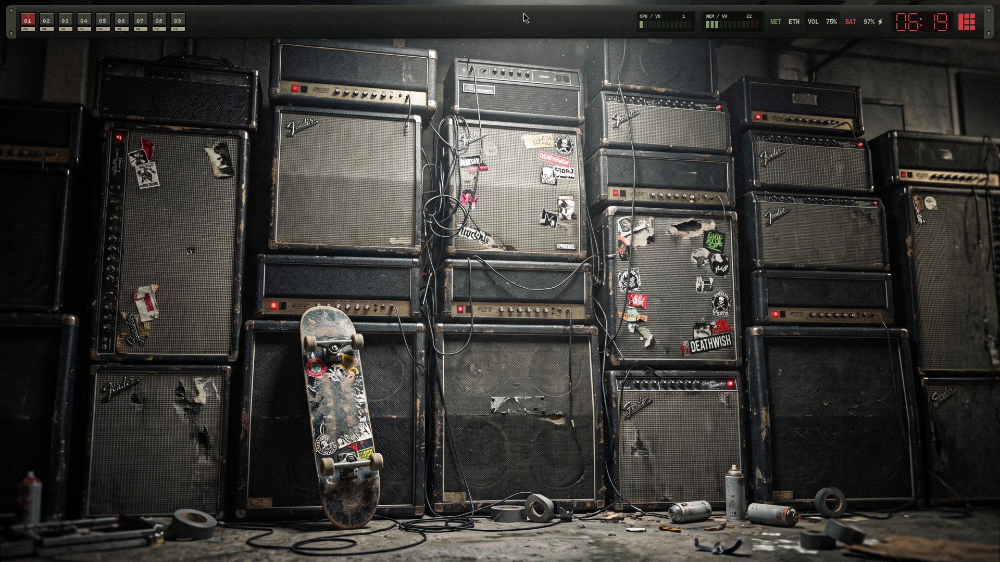](docs/screenshots/punk-show.png) | [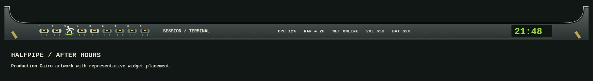](docs/previews/halfpipe-bar.png) |

| **Miss Rable (`rable`)** | **Dino Might (`dino`)** |
| :---: | :---: |
| [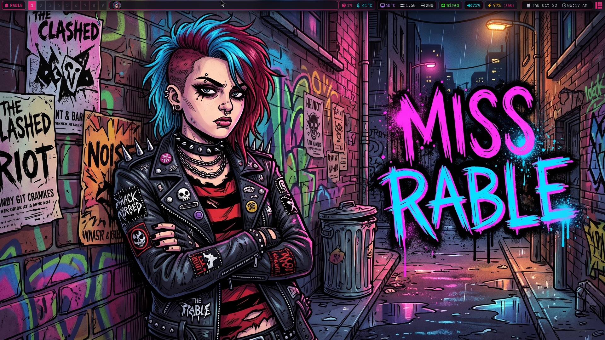](docs/screenshots/rable.png) | [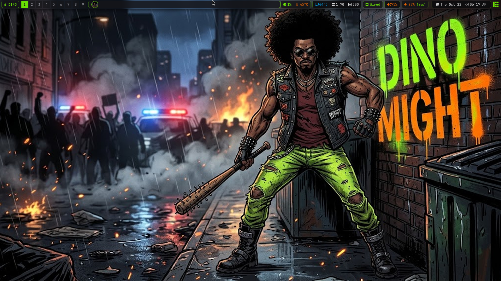](docs/screenshots/dino.png) |

| **Crust (`crust`)** | **Molly Tov (`tov`)** |
| :---: | :---: |
| [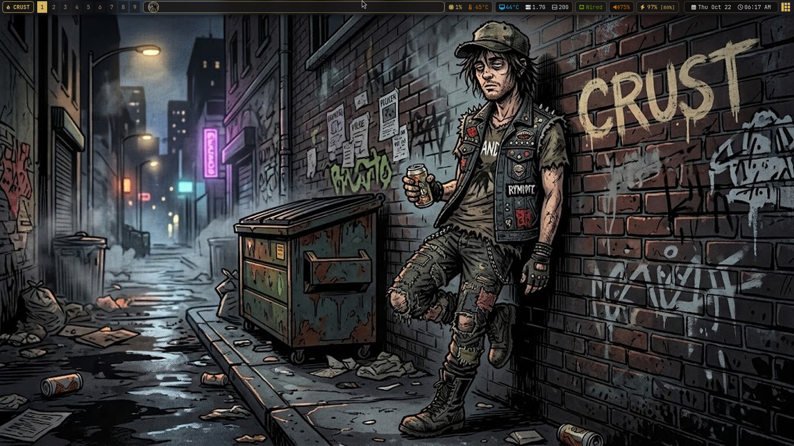](docs/screenshots/crust.png) | *(Desktop screenshot coming soon)* |

#### 🎨 5. Artistic, Whimsical & Light
- **Eeyore — Watercolor Sky (`eeyore`)**: Modern floating cloud-white bar with gentle sky-blue and sage accents.
- **Sugar Rush (`sugar-rush`)**: Frosted candy chainsaw bar with lavender teeth and sprinkle telemetry.
- **Crayon Chomp (`crayon-chomp`)**: Construction paper bar with broken wax crayon strokes and scribbled meters.
- **Mothgomery (`mothgomery`)**: Steampunk moth inventor workshop with lamplit brass and glass.
- **Baron von Gill (`gill`)**: Deep subterranean bioluminescent grotto creature theme.
- **Sketchbook (`sketchbook`)**: Light watercolor paper with graphite pencil strokes and clipped binder corners.

| **Eeyore — Watercolor Sky (`eeyore`)** | **Sugar Rush (`sugar-rush`)** |
| :---: | :---: |
| [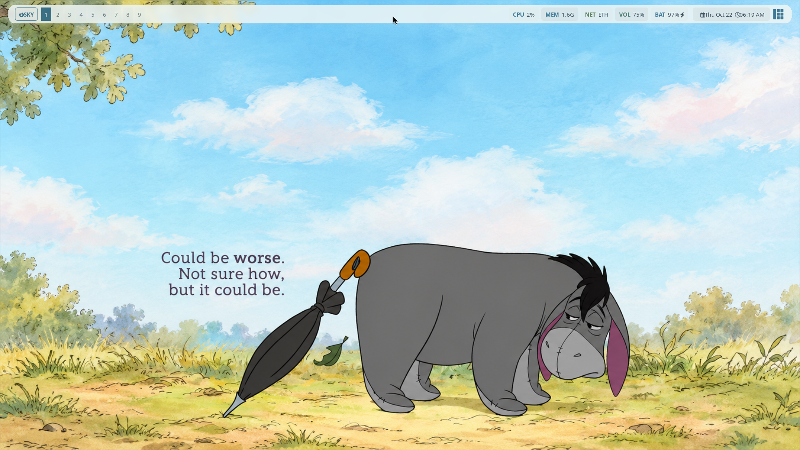](docs/screenshots/eeyore.png) | [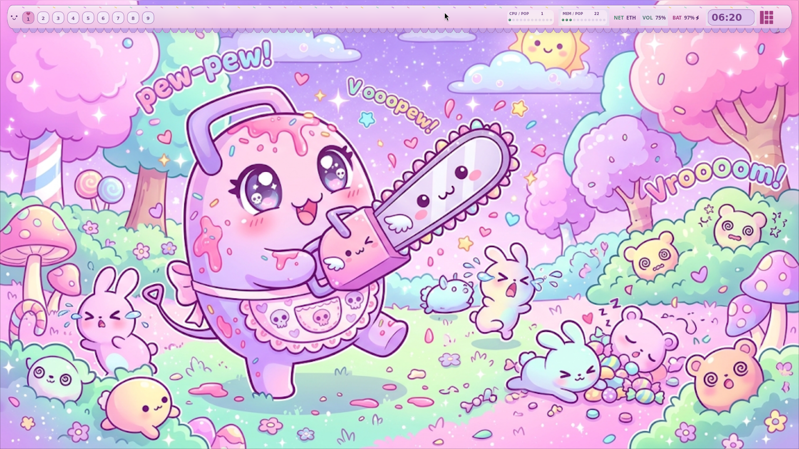](docs/screenshots/sugar-rush.png) |

| **Crayon Chomp (`crayon-chomp`)** | **Mothgomery (`mothgomery`)** |
| :---: | :---: |
| [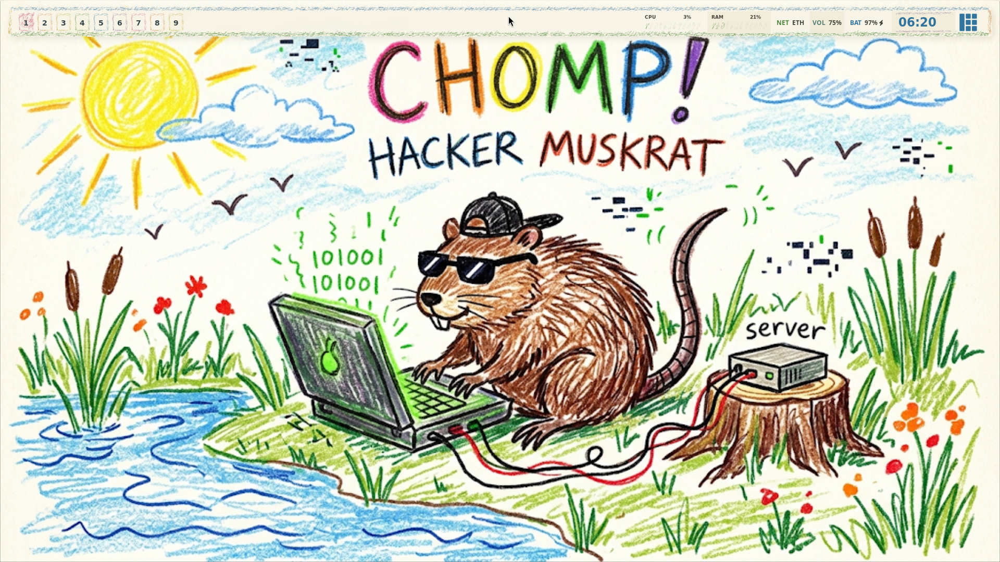](docs/screenshots/crayon-chomp.png) | [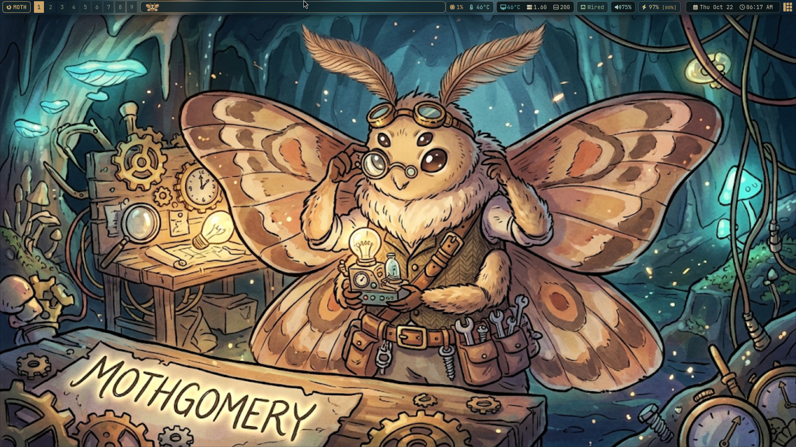](docs/screenshots/mothgomery.png) |

| **Baron von Gill (`gill`)** | **Sketchbook (`sketchbook`)** |
| :---: | :---: |
| [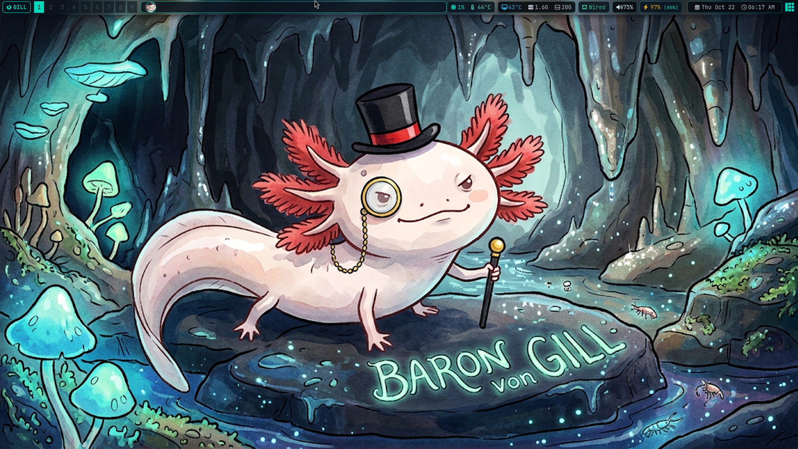](docs/screenshots/gill.png) | [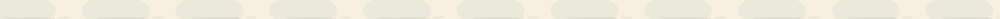](docs/previews/sketchbook-bar.png) |

#### 🐙 6. Eldritch, Ocean & Dark Cult
- **Grindhouse JAWS (`jaws`)**: Deep ocean blues, vintage pulp poster cream, and blood-in-the-water crimson.
- **The Well (`moonlit-well`)**: Mossy stone well curb, moonlit waters, and creeping eldritch tentacles.
- **I'm Sorry Jon (`jon`)**: Cosmic Garfield feline horror with void tentacles and lasagna orange accents.
- **Vaporwave Schizoid (`vaporwave-schizoid`)**: Broken holographic wireframe pyramids, neon scanlines, and lost signals.
- **Satanic Panic! (`satanic-panic`)**: Tarnished sacrificial dagger bar, dried oxblood crust, and occult VHS tracking.
- **The Bamboo Corsair (`bamboo-corsair`)**: Ghost pirate ship with violet sails, mist, and bamboo emerald accents.

| **Grindhouse JAWS (`jaws`)** | **The Well (`moonlit-well`)** |
| :---: | :---: |
| [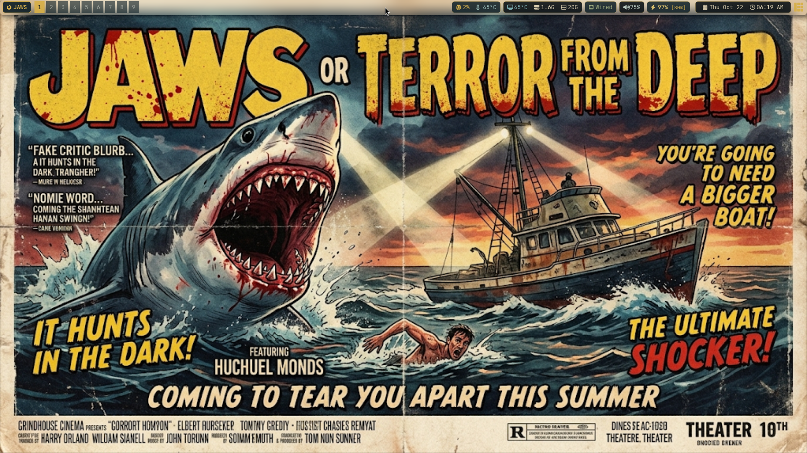](docs/screenshots/jaws.png) | [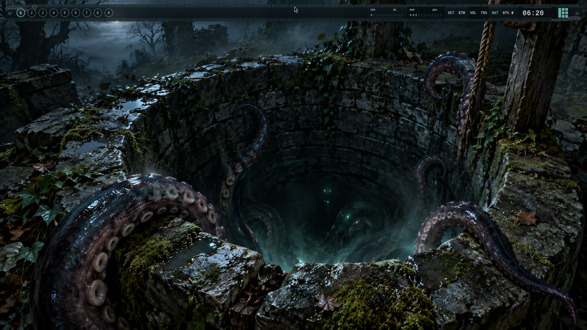](docs/screenshots/moonlit-well.png) |

| **I'm Sorry Jon (`jon`)** | **Vaporwave Schizoid (`vaporwave-schizoid`)** |
| :---: | :---: |
| [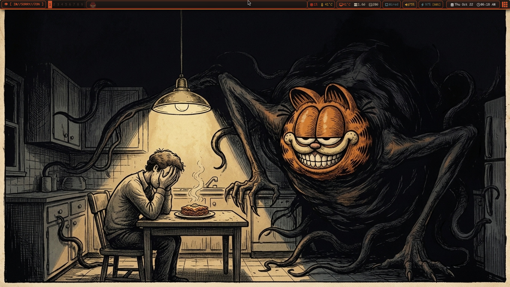](docs/screenshots/jon.png) | [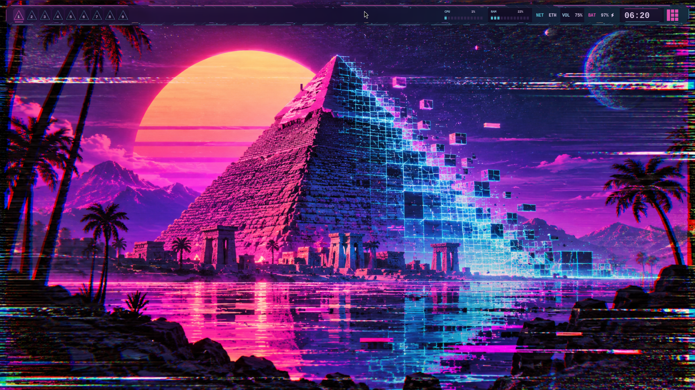](docs/screenshots/vaporwave-schizoid.png) |

| **Satanic Panic! (`satanic-panic`)** | **The Bamboo Corsair (`bamboo-corsair`)** |
| :---: | :---: |
| [](docs/previews/satanic-panic-bar.png) | *(Desktop screenshot coming soon)* |

---

## 🎨 Flagship Color Reference (Biohazard Slime)

| Swatch | Name | Hex Code | Role |
| :--- | :--- | :--- | :--- |
| 🟢 | **Slime Base** | `#0c140d` | Root desktop canvas, murky swamp wibar background |
| 🟢 | **Swamp Dark** | `#122015` | Widget container cards, tag pills, inactive window borders |
| 🟢 | **Murky Green** | `#25452a` | Tasklist cards, secondary selections, subtle frames |
| 🟢 | **Toxic Slime** | `#55f736` | Active window focus border, notifications, primary accents |
| 🟢 | **Neon Lime** | `#74ff2e` | Focused cursor, active workspace tags, glow highlights |
| 🟡 | **Acid Yellow** | `#d8eb34` | Drip tips, warning temperatures (≥70°C), modifier keys |
| 🟡 | **Pale Lichen** | `#c6f582` | Terminal foreground text, readable UI labels, clock pill |
| 🔴 | **Hazard Red** | `#ff4343` | Critical alerts, battery ≤20%, mute states, compiler errors |

*Detailed color specifications for all other themes are documented in `pads/theme.py`, `config/awesome/themes/*.lua`, and the respective guides in `docs/`.*

---

## 📁 Repository Layout

```text
~/Projects/slime/
├── README.md                           # Master project documentation & theme catalog
├── sync.sh                             # Deployment, backup, diff, and restore utility
├── .agents/skills/slime-theme/SKILL.md # Complete theme creation & wiring runbook
├── config/                             # Live configuration mirrors (~/.config/)
│   ├── alacritty/                      # 38 Alacritty theme configurations (strict 7pt size)
│   ├── awesome/                        # AwesomeWM 4.3 modular desktop suite
│   │   ├── rc.lua                      # Master entrypoint & lifecycle management
│   │   ├── theme_mode                  # Active theme persistence state file
│   │   ├── config/                     # Modular bindings: apps, keys, rules, scratchpads
│   │   ├── theme/                      # slime_shapes.lua (Cairo vector bar renderers)
│   │   ├── themes/                     # 38 standalone modular theme definition tables
│   │   └── ui/                         # bar.lua (companion factory), quick menu, notifications
│   ├── btop/themes/                    # 38 btop++ system monitor color themes
│   ├── fastfetch/                      # 38 TrueColor ANSI ASCII mascot & logo art banners
│   ├── gtk-3.0/ & gtk-4.0/             # GTK dark styling & font synchronization
│   ├── kitty/                          # 38 Kitty terminal color configurations
│   ├── lxterminal/                     # 38 LXTerminal lightweight terminal profiles
│   ├── nvim/                           # Neovim config + 38 colorschemes (nvim/colors/*.lua)
│   ├── picom/                          # 38 Picom compositor configurations (GLX + dual-kawase)
│   ├── rofi/                           # 38 Rofi launcher themes (*.rasi)
│   ├── starship-*.toml                 # 38 Starship prompts (status code hardened)
│   ├── tmux/themes/                    # 38 Tmux statusline theme profiles
│   ├── xdg-desktop-portal/             # Wayland/X11 portal configurations
│   ├── xsettingsd/                     # X11 DPI, cursor, and font configuration
│   ├── mpv/ & yt-dlp/                  # Hardware-accelerated media player configs
├── bin/                                # Custom user scripts & binaries (~/.local/bin/)
│   ├── theme-toggle                    # Master dynamic modular theme switcher
│   ├── theme-console                   # Dynamic theme companion console launcher
│   ├── apply-power-limits.sh           # ASUS TUF FX505DY TDP/PPT power capping script
│   ├── battery-threshold               # Passwordless UPower 80% / 100% charge toggle
│   ├── dots                            # Dotfile management wrapper
│   ├── play & termplay                 # Terminal media playback tools
│   ├── powerprofilesctl                # busctl wrapper for power-profiles-daemon
│   ├── qtile-fzf                       # Fuzzy application finder dropdown
│   ├── qtile-notes                     # Quick timestamped persistent note scratchpad
│   ├── qtile-screenshot                # Full, active-window, and region screenshot tool
│   ├── sorted                          # Downloads organizer with safe JSON notification serialization
│   ├── *-fetch                         # Themed TrueColor sysinfo fetchers (slime, chomp, speedster...)
│   └── *-pad                           # Themed persistent terminal scratchpad launchers
├── pads/                               # 11 Tkinter Python GUI dropdown desktop tools
│   ├── theme.py                        # Centralized 38-theme palette engine & typography
│   ├── font_pad.py                     # Dynamic desktop font selector & system-wide tuner
│   ├── audio_pad.py                    # PipeWire / WirePlumber volume & device manager
│   ├── clip_pad.py                     # Clipboard history search & copy manager
│   ├── docker_pad.py                   # Docker container & service monitor
│   ├── emoji_pad.py                    # Searchable emoji picker
│   ├── key_cheat.py                    # Live desktop keybinding cheatsheet
│   ├── log_pad.py                      # Systemd journal viewer & filter
│   ├── vim_cheat.py                    # Neovim / Vim cheatsheet dropdown
│   ├── weather_pad.py                  # Live wttr.in weather forecast dashboard
│   ├── wifi_pad.py                     # NetworkManager Wi-Fi scanner & connection manager
│   └── zodiac_pad.py                   # Astronomical calendar & zodiac tool
├── tests/                              # Automated test suite (Python unittest)
│   ├── test_theme_parity.py            # Verifies all 38 themes, font sizes, Neovim schemes, keys
│   ├── test_bar_autohide.py            # Verifies invisible top edge reveal & dismissal geometry
│   ├── test_desktop_regressions.py     # Verifies floating geometry, pad palettes, restore safety
│   └── test_*.py                       # Specialized theme render & shape tests
├── wallpaper/                          # High-resolution wallpapers for all 38 themes
└── docs/                               # Detailed guides, previews & desktop screenshots
    ├── previews/                       # Procedural Cairo bar render previews
    ├── screenshots/                    # Full 1080p desktop screenshots across 31 themes
    └── *.md                            # Standalone theme reference manuals
```

---

## ⌨️ Desktop Keybindings

### Window Management & AwesomeWM

| Shortcut | Action | Description |
| :--- | :--- | :--- |
| **`Super + q`** | `client:kill()` | Close focused window (also `Alt + F4` / `Super + Shift + c`) |
| **`Super + f`** | `fullscreen` | Toggle fullscreen mode |
| **`Super + Control + space`** | `floating` | Toggle floating state for focused window |
| **`Super + Control + Return`**| `swap master` | Promote focused window to master client |
| **`Super + j` / `k`** | `focus.byidx` | Cycle focus to next / previous window |
| **`Super + Shift + j` / `k`** | `swap.byidx` | Swap position with next / previous window |
| **`Super + h` / `l`** | `tag.incmwfact`| Adjust master width factor (shrink / grow) |
| **`Super + Shift + h` / `l`** | `tag.incnmaster`| Increase / decrease number of master windows |
| **`Super + space`** | `layout.inc(1)` | Switch to next window layout (tile, float, magnify...) |
| **`Super + Control + r`** | `awesome.restart` | Reload AwesomeWM configuration in place |
| **`Super + Shift + q`** | `awesome.quit` | Exit AwesomeWM / log out |
| **`Super + Control + F1`**| `hotkeys_popup` | Display native AwesomeWM keybinding help |

### Theme Navigation & Typography

| Shortcut | Action | Description |
| :--- | :--- | :--- |
| **`Super + o`** | `theme-toggle` | **Cycle forward to the next theme** across all 38 themes |
| **`Super + Shift + o`** | `theme-toggle random` | **Switch instantly to a random theme** |
| **`Super + Shift + f`** | `font_pad.py` | Open the **Dynamic Font Chooser** to retune typography |

### Application Launchers

| Shortcut | Application | Description |
| :--- | :--- | :--- |
| **`Super + Return`** | `alacritty` | Launch Alacritty terminal emulator |
| **`Super + b`** | `firefox` | Launch Firefox web browser |
| **`Super + d`** | `rofi -show drun` | Open Rofi application launcher |
| **`Super + r`** | `promptbox` | Open wibar run prompt |
| **`Super + p`** | `menubar` | Open desktop menubar |
| **`Control + Mod1 + l`**| `slock` | Lock screen immediately |

### Python GUI Dropdown Pads (`pads/`)

*Ephemeral pads reclaim memory immediately upon closing; persistent scratchpads retain state.*

| Shortcut | Dropdown Pad | Description |
| :--- | :--- | :--- |
| **`Super + a`** | `audio_pad.py` | PipeWire / WirePlumber volume slider & device switcher |
| **`Super + i`** | `wifi_pad.py` | NetworkManager Wi-Fi scanner, signal strength & connection |
| **`Super + x`** | `clip_pad.py` | Clipboard history search and paste buffer |
| **`Super + t`** | `btop-float` | Floating Alacritty terminal running btop system monitor |
| **`Super + w`** | `weather_pad.py`| Multi-day weather forecast dashboard |
| **`Super + n`** | `log_pad.py` | Systemd journalctl viewer and log filter |
| **`Super + Shift + d`**| `docker_pad.py` | Docker container and service status dashboard |
| **`Super + v`** | `vim_cheat.py` | Neovim / Vim modal navigation cheatsheet |
| **`Super + s`** | `qtile-notes` | Quick timestamped terminal note pad (persistent) |
| **`Super + F1`** | `key_cheat.py` | Interactive Slime desktop shortcut cheatsheet |
| **`Super + z`** | `zodiac_pad.py` | Astronomical calendar, moon phase & zodiac data |
| **`Super + m`** | `emoji_pad.py` | Searchable Unicode emoji picker |
| **`Super + y`** | `limusic-app` | Limusic streaming audio player scratchpad |
| **`Super + /`** | `qtile-fzf` | Fast fzf file search & opener dropdown |

### Consoles & Mascot Terminals

| Shortcut | Console Target | Description |
| :--- | :--- | :--- |
| **`F12`** | `theme-console` / Active Mascot | Open companion console for active theme (Chomp, Speedster, Gill...) |
| **`Super + g`** | `agy-pad` | Antigravity AI coding assistant dropdown (persistent) |
| **`Super + Control + c`**| `chomp-pad` | Chomp the Haxor terminal scratchpad (persistent) |
| **`Super + Control + t`**| `tunes-pad` | Looney Tunes cartoon console dropdown (persistent) |
| **`Super + Shift + g`**| `gill-pad` | Baron von Gill grotto console dropdown |
| **`Super + Shift + r`**| `rable-pad` | Miss Rable neon punk console dropdown |
| **`Super + Shift + m`**| `tov-pad` | Molly Tov anarchist riot console dropdown |
| **`Super + Shift + b`**| `dino-pad` | Dino Might bruiser console dropdown |
| **`Super + Shift + u`**| `crust-pad` | Crust drifter console dropdown |
| **`Super + Shift + v`**| `mystery-pad` | Mystery Machine flower power console dropdown |
| **`Super + Shift + p`**| `darkwing-pad`| Darkwing Duck superhero vigilante console dropdown |
| **`Super + Shift + s`**| `tmnt-pad` | Ninja Turtles cowabunga console dropdown |
| **`Super + Shift + e`**| `muppet-pad` | Muppet Babies vaporwave console dropdown |
| **`Super + Shift + i`**| `jon-pad` | I'm Sorry Jon eldritch feline console dropdown |

### Hardware, Audio & Media Keys

| Shortcut | Utility | Description |
| :--- | :--- | :--- |
| **`Print`** | `qtile-screenshot full` | Take full-desktop screenshot to `~/Pictures/Screenshots` & clipboard |
| **`Super + Print`** | `qtile-screenshot window` | Capture currently focused window |
| **`Shift + Print`** | `qtile-screenshot region` | Interactive rectangular crop screenshot selection |
| **`XF86AudioRaiseVolume`** | `wpctl 5%+` | Raise PipeWire master volume & refresh status pill |
| **`XF86AudioLowerVolume`** | `wpctl 5%-` | Lower PipeWire master volume & refresh status pill |
| **`XF86AudioMute`** | `wpctl toggle` | Toggle audio mute (turns status pill hazard red) |
| **`XF86AudioMicMute`** | `wpctl mic-toggle` | Toggle microphone input mute |
| **`XF86MonBrightnessUp`** | `brightnessctl +10%`| Increase display backlight brightness |
| **`XF86MonBrightnessDown`**| `brightnessctl 10%-`| Decrease display backlight brightness |

---

## ⚡ Status Bar Telemetry & Autohide

### Universal Invisible-Edge Autohide
Every theme's top wibar starts hidden:
- **Reveal**: Move mouse pointer to the invisible **2-pixel edge strip** along the top of any display.
- **Overlay Mode**: The bar overlays the screen without altering window layout, reserving strut space, or resizing active tiled clients.
- **Auto-Retract**: Leaves screen smoothly ~0.5s after the pointer exits the bar area.

### Status Pills & Telemetry Actions

- **CPU Pill (``):** Real-time processor load percentage and AMD `k10temp` package temperature. Left-click launches floating `btop`.
- **System Pill (``):** AMD Radeon GPU temperature, used system RAM (`GiB`), and free root filesystem disk space (`GiB`). Left-click launches floating `btop`.
- **Network Pill (`` / ``):** Live Wi-Fi SSID with signal strength or `Wired` ethernet status. Left-click launches `wifi_pad.py`.
- **Volume Pill (``):** Current volume percentage. Turns hazard red (` %`) when muted. Left-click opens `audio_pad.py`, right-click toggles mute, mouse scroll adjusts volume ±5%.
- **Battery Pill (``):** Battery charge level, AC charging status, and active charge ceiling badge (`[80%]` or `[100%]`). Left-click cycles power profile (`power-saver` ↔ `balanced`); right-click toggles the UPower 80% battery longevity threshold.
- **Clock Pill (``):** Formatted date and time. Left-click launches `weather_pad.py`, right-click launches `zodiac_pad.py`.
- **Companion Mascot Launcher:** Left-most icon launches the theme's custom interactive console or ASCII sysinfo dashboard.

---

## 🔄 Workflow: Backup, Modify, Restore & Test

### 1. Re-sync live changes into the repository
Whenever you make live desktop modifications in `~/.config/` or `~/.local/bin/`:
```bash
cd ~/Projects/slime
./sync.sh
```
`sync.sh` copies modified files from your live desktop into the repository, stages them, and displays `git status`.

### 2. Review diffs and commit
```bash
cd ~/Projects/slime
git diff
./sync.sh --commit "Describe recent theme or script updates"
```

### 3. Restore repository configs to live desktop
To push changes from `~/Projects/slime` back to `~/.config/`, `~/.local/bin/`, and `~/Projects/qtile_bench/`:
```bash
cd ~/Projects/slime
./sync.sh --restore
```
> [!NOTE]
> `sync.sh --restore` automatically generates a timestamped safety backup in `~/.slime_backup_<timestamp>` before overwriting any files, then safely restarts AwesomeWM.

### 4. Run the Automated Verification Test Suite
Run the full 31-test suite to confirm zero regressions, proper terminal font sizes, valid Neovim highlight configurations, and conflict-free keyboard shortcuts:
```bash
cd ~/Projects/slime
python -m unittest discover -s tests -v
```

To run only the cross-theme parity verification:
```bash
python -m unittest discover -s tests -p 'test_theme_parity.py' -v
```

---

## 🛠️ Creating New Themes

To design and wire a new theme into the ecosystem, refer to the step-by-step standard defined in:
👉 [`.agents/skills/slime-theme/SKILL.md`](.agents/skills/slime-theme/SKILL.md)

The runbook details the **15-Component Integration Checklist**:
1. Wallpaper extraction & placement (`wallpaper/`)
2. Cairo vector bar renderer in [`config/awesome/theme/slime_shapes.lua`](config/awesome/theme/slime_shapes.lua)
3. AwesomeWM theme definition in `config/awesome/themes/<name>.lua`
4. Companion profile registration in [`config/awesome/ui/bar.lua`](config/awesome/ui/bar.lua)
5. Alacritty profile with strict 7.0pt font sizing (`config/alacritty/<name>.toml`)
6. Kitty terminal profile (`config/kitty/<name>.conf`)
7. LXTerminal configuration (`config/lxterminal/<name>.conf`)
8. Tmux statusline theme (`config/tmux/themes/<name>.conf`)
9. Rofi launcher theme (`config/rofi/<name>.rasi`)
10. Picom compositor profile (`config/picom/<name>.conf`)
11. Starship prompt with `[status] disabled = false` (`config/starship-<name>.toml`)
12. Neovim colorscheme with `Normal` foreground (`config/nvim/colors/<name>.lua`)
13. Btop++ theme palette (`config/btop/themes/<name>.theme`)
14. Tkinter pad centralized palette registration in [`pads/theme.py`](pads/theme.py)
15. Fastfetch ASCII banner art & companion scripts (`bin/<name>-fetch`, `bin/<name>-pad`)
16. Registration in [`bin/theme-toggle`](bin/theme-toggle) canonical list and alias case statement
17. Automated verification via `python -m unittest discover -s tests -p 'test_theme_parity.py'`
