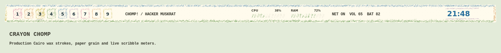

# Crayon Chomp — Hacker Muskrat

The supplied illustration is preserved in `wallpaper/crayon-chomp.png`.
Warm paper, pond blue, grass green, ochre, brown, and purple carry into the
terminal, launcher, editor, notifications, tmux, system monitor, and pads.




The detached 64-pixel bar has a 10-pixel top gap, 12-pixel side insets, and
12 pixels of clearance above tiled windows. Its irregular paper silhouette,
fine paper grain, and three offset border passes are drawn by Cairo. Each pass
varies pressure and skips deposits, exposing patches of paper. Short overlapping
diagonal fill strokes extend slightly beyond workspace outlines.
Deterministic texture stays still during telemetry updates. Colored scribble
workspace markers retain tag interactions; selected tags gain a dark underline.
CPU and RAM meters fill with diagonal crayon strokes. Existing network, volume,
battery, tasklist, tray, clock, and layout interactions remain available.

Activate after deployment with `theme-toggle crayon-chomp` (alias `crayon`).
No active theme files are changed by creating this theme.

Validation:

```sh
python -m unittest discover -s tests -p test_crayon.py
lua5.3 tools/preview_crayon.lua
```

The preview shows the production Cairo renderer with representative widget
placement, not a live desktop screenshot.
