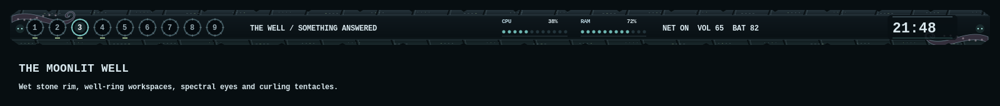

# The Well — Something Answered

No one remembers when the well appeared. For as long as anyone knew of it,
it had always been there. Tonight, something climbed out.

Built around the original `Moonlit Eldritch Well.png`, preserved unchanged as
`wallpaper/moonlit-well.png`. Blue-black wet stone, silver moonlight, faded moss,
and the creature's teal glow carry across the desktop.


| Role | Color |
| --- | --- |
| Shaft darkness | `#080f13` |
| Wet stone surface | `#142229` |
| Moonlight text | `#d9e7ec` |
| Eldritch glow / focus | `#79c9c3` |
| Moonlit slate | `#9bb9cb` |
| Moss | `#9bb789` |
| Tentacle mauve | `#aa95b1` |
| Alerts | `#cd8792` |

The detached 64-pixel bar has a chipped masonry rim, curled tentacles, and eyes
peering from either end. Workspaces are numbered stone well rings, with a teal
selected ring and a moss mark for occupied workspaces. CPU and RAM use glowing
bead meters; the clock is a moonlit stone plaque. Existing top-edge autohide,
CPU/system clicks, tooltips, and workspace interactions remain available.



Includes AwesomeWM, Kitty, Alacritty, LXTerminal, tmux, Rofi, Picom, Starship,
btop, Neovim, and Python pads. Focused windows are opaque; inactive windows use
87% opacity with gentle blur. Decoration is static and needs no animation timer.

Activate with `theme-toggle moonlit-well` (aliases: `moonlit`, `well`, `eldritch`).
Return to the previous desktop with `theme-toggle punk-show`.

Validation:

```sh
lua5.3 tools/preview_well.lua
python -m unittest discover -s tests -p test_moonlit_well.py -v
python -m unittest discover -s tests -p test_theme_parity.py -v
awesome -k -c config/awesome/rc.lua
```
