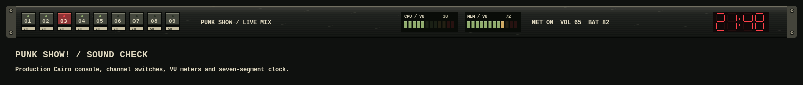

# Punk Show! — Sound Check

A worn mixing-console desktop drawn from the supplied wall-of-amplifiers
wallpaper: charcoal metal, dusty cream labels, red pilot lights, olive LEDs,
and aged brass. The original download is preserved as `wallpaper/punk-show.jpg`.




The detached 64-pixel bar has slotted rack screws, a brushed faceplate, scratches,
and beveled channel switches. Its nine numbered channel buttons retain the usual
workspace clicks and scroll bindings. The selected channel has a pressed red
face and pilot light; occupied channels have olive lights and urgent ones red.
CPU and memory are genuine 12-segment meters updated by the existing two-second
telemetry loop. CPU shows utilization; memory shows the percentage in use from
`MemTotal` and `MemAvailable`. High segments transition from olive through amber
to red. Each meter also shows a numeric percentage and keeps the btop click.

The red clock uses Cairo seven-segment digits, so no digital font installation
is required. It shows 24-hour local time and redraws when the minute changes.
Clock clicks still open the weather and calendar pads. Network, volume, battery,
tray, tasklist and layout controls remain available.

The bar sits 10 logical pixels below the top and 12 pixels in from either side,
with 12 pixels between it and tiled windows. It follows monitor geometry and DPI.
Matching clipped panels, red focus borders, terminals, Rofi, tmux, Starship,
btop, Neovim and Python pads complete the workspace. Inactive windows use 87%
opacity and focused windows remain solid. The supplied wallpaper fills the
desktop while preserving its aspect ratio; differing screen ratios can crop it.

Activate with `theme-toggle punk-show`. Aliases: `punk`, `punkshow`, `soundcheck`.
Installation leaves the active theme unchanged.

```sh
python -m unittest discover -s tests -p test_punk_show.py
lua5.3 tools/preview_punk_show.lua
```

The preview uses production Cairo renderers with representative widget placement;
it is not a live desktop screenshot.
