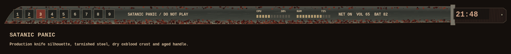

# Satanic Panic — Do Not Play

The supplied VHS occult desk artwork is preserved in `wallpaper/satanic-panic.png`.



A detached 70-pixel knife bar has a curved steel blade, a metal guard, and a
riveted dark handle. Grinding scratches and angular, cracked oxblood flakes
suggest tarnish and dried blood. Texture stays fixed between redraws, with a
clear central lane for readable controls. Workspaces use etched numbered plates;
CPU and RAM meters retain live values and the clock updates across midnight.

The theme includes aged parchment text, charcoal surfaces, burnt red accents,
and matching terminal, launcher, editor, tmux, monitor, notifications, and pad
palettes. It uses the existing 12-pixel side insets, 10-pixel top gap, and
12-pixel clearance above tiled windows.

After deployment, select `theme-toggle satanic-panic` (alias `panic`). Creating
this theme leaves Crayon Chomp active. The preview uses production Cairo drawing
with representative widget placement, not a live desktop screenshot.

```sh
python -m unittest discover -s tests -p test_satanic_panic.py
lua5.3 tools/preview_satanic_panic.lua
```
