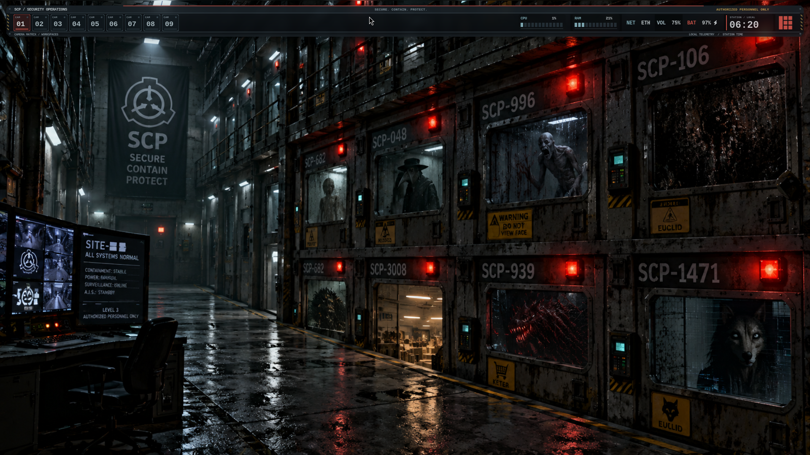
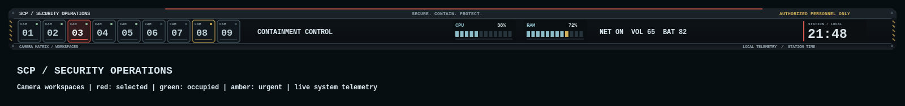

# SCP Facility — Security Operations

A security dashboard matched to `SCP Containment Corridor_ Secure, Contain,
Protect.png`. The original artwork is preserved unchanged in
`wallpaper/scp-facility.png`.





The 80-pixel detached console has gunmetal panels, a restricted-access header,
hazard markings, nine camera-style workspace tiles, segmented CPU/RAM meters,
and a local station clock. The center area shows running tasks; the preview uses
an example task label. Workspace numbers remain the usual 1–9 shortcuts.

Red frames indicate the selected workspace, green lamps indicate occupied
workspaces, and amber indicates urgency. Camera labels are decorative workspace
labels. CPU, RAM, clock, network, audio, and battery retain their actual desktop
data and existing actions. The bar retains top-edge autohide.

| Role | Color |
| --- | --- |
| Console background | `#0b0f12` |
| Gunmetal panels | `#1a2228` |
| Monitor text | `#d8e1e5` |
| Containment red / focus | `#d6584d` |
| Warning amber | `#d5af58` |
| Telemetry blue | `#8dbdc9` |
| Occupied indicator | `#8cba99` |

Includes AwesomeWM, Kitty, Alacritty, LXTerminal, tmux, Rofi, Picom, Starship,
btop, Neovim, and Python pads. Focused windows are opaque; unfocused windows use
87% opacity with blur. All decorative indicators are static.

Activate from a desktop terminal:

```sh
theme-toggle scp-facility
```

Aliases: `scp`, `containment`, `facility`. Return to The Well with
`theme-toggle moonlit-well`.

Validation:

```sh
lua5.3 tools/preview_scp.lua
python -m unittest discover -s tests -p test_scp_facility.py -v
python -m unittest discover -s tests -p test_theme_parity.py -v
awesome -k -c config/awesome/rc.lua
```
