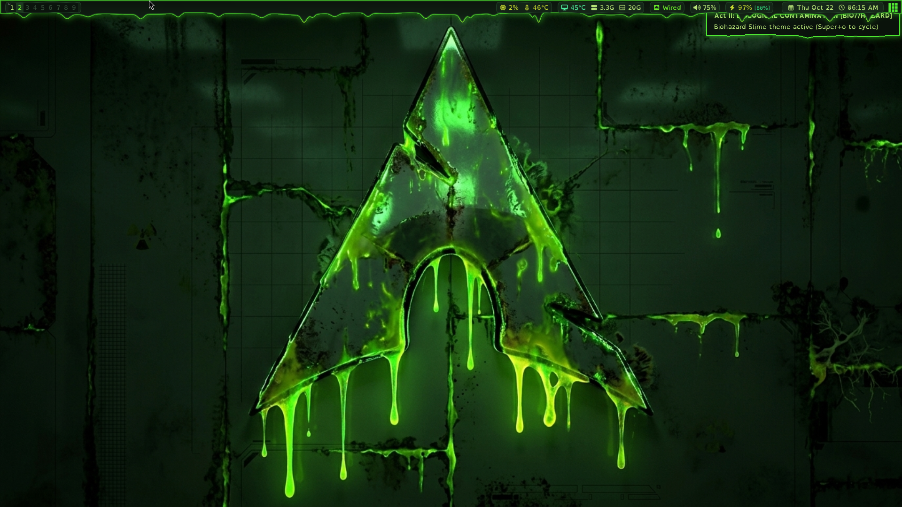

# Slime Rice — Design System & Configuration

## 1. Aesthetic Direction
* **Concept:** Slime / Biohazard / Radioactive Swamp
* **Style:** All rounded corners, borderless windows (`titlebars_enabled = false`), subtle translucent blur, glowing radioactive neon accents over deep murky moss/black backgrounds.
* **Palette Philosophy:**
  * **Backgrounds:** Murky, dark swamp greens and charcoal (`#0c140d`, `#122015`).
  * **Accents & Foreground:** Radiating lime greens, electric chartreuse, toxic yellows (`#55f736`, `#74ff2e`, `#d8eb34`, `#c6f582`).
  * **Alerts / Errors:** Vivid, unmistakable warning red (`#ff4343`, `#ff6666`) — the *only* traditional defaultish hue, ensuring errors, muted audio, high temperatures, and urgent tags instantly command attention.

---

## 2. Color Palette Reference

| Swatch | Name | Hex Code | Role |
| :--- | :--- | :--- | :--- |
| 🟢 | **Slime Base** | `#0c140d` | Window background, status bar background |
| 🟢 | **Swamp Dark** | `#122015` | Widget container pills, inactive borders, tag background |
| 🟢 | **Murky Green** | `#25452a` | Selections, inactive task cards, borders |
| 🟢 | **Toxic Slime** | `#55f736` | Active window border, notifications, focused indicators |
| 🟢 | **Neon Lime** | `#74ff2e` | Active tag text, focused cursor, high-priority highlights |
| 🟡 | **Acid Yellow** | `#d8eb34` | Secondary highlights, warning temps, modifier keys |
| 🟡 | **Pale Lichen** | `#c6f582` | Terminal foreground, readable UI text |
| 🔴 | **Hazard Red** | `#ff4343` | Stand-out compiler/system errors, muted state, critical alerts |

---

## 3. Implemented Components

### AwesomeWM ([~/.config/awesome/](file:///home/jaws/.config/awesome/))
* **Theme ([theme/theme.lua](file:///home/jaws/.config/awesome/theme/theme.lua)):**
  * `useless_gap`: `6px`
  * `border_width`: `2px` (Normal: `#152417`, Focus: `#55f736`)
  * `font`: `MartianMono Nerd Font 9`
  * `wallpaper`: `~/Pictures/wallpaper/slime.jpg`
* **Cairo Dripping Slime Shapes ([theme/slime_shapes.lua](file:///home/jaws/.config/awesome/theme/slime_shapes.lua) & [config/signals.lua](file:///home/jaws/.config/awesome/config/signals.lua)):**
  * **Super-Sampled Antialiasing:** Explicitly enforces `CAIRO_ANTIALIAS_BEST` across all shape path generators and Cairo gradient/glow renderers for maximum subpixel edge fidelity.
  * **Dripping Wibar (`dripping_bar` + `render_bar_bg`):** `52px` tall (`34px` top strut + `22px` hanging slime tendrils overlapping the top gap) with an X11 Cairo shape mask, murky swamp slime gradient (`#0c140d` → `#112014` → `#1a371e`), inner neon halo, and `#55f736 -> #d8eb34` glowing rim along the drip tips.
  * **Modern Dripping Windows (`dripping_window` + `render_window_bottom_drips`):** Clean, crisp straight top/left/right edges with `12px` rounded corners and sleek translucent glass borders (`#55f73677` on focus, `#15241777` on unfocus), with organic hanging slime drips and droplets pooling exclusively along the `18px` bottom margin canvas.
  * **Wobbly Gel Pills (`wobbly_pill`):** Organic wobbly capsule shapes for all status bar telemetry pills and tasklist tabs.
* **Live Telemetry Status Bar ([ui/bar.lua](file:///home/jaws/.config/awesome/ui/bar.lua)):**
  * **CPU Pill (``):** Live CPU utilization % + AMD `k10temp` temperature (turns yellow ≥70°C, red ≥85°C). Click toggles `btop-float`.
  * **System Pill (``):** AMD GPU (`amdgpu`) temperature + used RAM (`GiB`) + free `/` disk space (`GiB`). Click toggles `btop-float`.
  * **Network Pill (`` / `󰈀`):** Live Wi-Fi SSID or `󰈀 Wired` via `nmcli` (or red `Offline` when disconnected). Click toggles `wifi_pad.py`.
  * **Volume Pill (``):** Live PipeWire volume % via `wpctl` (turns hazard red ` %` when muted). Left-click toggles `audio_pad.py`, right-click toggles mute, scroll wheel adjusts ±5%.
  * **Battery Pill (``):** Live `/sys/class/power_supply/BAT0` capacity & charging status (turns hazard red ≤20% on battery; displays `[80%]` badge when capped). Left-click toggles power profile (`power-saver` ↔ `balanced`); right-click toggles battery charge threshold (`80%` ↔ `100%`) via UPower with instant notifications.
  * **Clock Pill (``):** Date and time in `#c6f582` (left-click toggles `weather_pad.py`, right-click toggles `zodiac_pad.py`).
* **Notifications ([ui/notifications.lua](file:///home/jaws/.config/awesome/ui/notifications.lua)):**
  * Shaped with `slime_shapes.dripping_window(10, 9, 2.9)`, translucent murky green body, slime green border for normal notifications, vivid hazard red (`#ff4343`) for critical errors.
* **Autostart ([config/autostart.lua](file:///home/jaws/.config/awesome/config/autostart.lua)):**
  * Launches `picom -b` and runs `~/.local/bin/sorted --once` to automatically organize `~/Downloads`.

### Picom Compositor ([~/.config/picom/picom.conf](file:///home/jaws/.config/picom/picom.conf))
* **Backend:** `glx` with hardware acceleration enabled
* **Cairo Shape Mask Integration:** `corner-radius = 0` so AwesomeWM's Cairo wobbly/dripping shape masks control window and bar contours without shader clipping
* **Phosphor Bloom Shadows:** Bioluminescent green shadow glow (`shadow-color = "#45e62b"`, `shadow-radius = 16`, `shadow-opacity = 0.50`)
* **Blur:** `dual_kawase` (strength 5)
* **Transparency:** Active windows opaque / terminal opacity controlled natively; unfocused windows `0.92` opacity; smooth fade transitions (`fade-delta = 10`)

### Kitty Terminal ([~/.config/kitty/kitty.conf](file:///home/jaws/.config/kitty/kitty.conf))
* **Font:** `MartianMono Nerd Font` (size 10.5)
* **Opacity:** `0.88` (slight transparency with dual-kawase blur underneath)
* **16-Color Palette:** Strict greens & yellows for colors 0, 2–8, 10–15; true bold red (`#ff4343` / `#ff6666`) for colors 1 & 9.

### Rofi Application Launcher ([~/.config/rofi/config.rasi](file:///home/jaws/.config/rofi/config.rasi))
* **Normal Window Integration:** Configured with `-normal-window` in [config/apps.lua](file:///home/jaws/.config/awesome/config/apps.lua) and floating/centered in [config/rules.lua](file:///home/jaws/.config/awesome/config/rules.lua).
* **Slime Drips:** Inherits the wobbly Cairo shape mask, `2px` glowing `#55f736` border, bottom slime drips, and phosphor bloom shadow. Internal CSS borders disabled so the Cairo slime mask frames the launcher seamlessly.

### Neovim & Btop Slime Themes
* **Neovim ([~/.config/nvim/init.lua](file:///home/jaws/.config/nvim/init.lua) & [~/.config/nvim/colors/slime.lua](file:///home/jaws/.config/nvim/colors/slime.lua)):**
  * Custom truecolor `slime` colorscheme with transparent background (inheriting Kitty's blur), slime green keywords/functions, toxic yellow types/constants, seafoam strings, and vivid hazard red (`#ff4343`) reserved exclusively for LSP/compiler errors and diagnostics.
* **Btop ([~/.config/btop/btop.conf](file:///home/jaws/.config/btop/btop.conf) & [~/.config/btop/themes/slime.theme](file:///home/jaws/.config/btop/themes/slime.theme)):**
  * Custom `slime` theme with `theme_background = false` for translucent blur, seafoam-to-toxic-yellow CPU/process graphs, and hazard red temperature/memory ceilings.

---

## 4. Keybindings & Python Scratchpads ([config/keys.lua](file:///home/jaws/.config/awesome/config/keys.lua))

All 10 standalone Tkinter dashboard dropdowns ([~/Projects/qtile_bench/](file:///home/jaws/Projects/qtile_bench/)) and terminal scratchpads are managed via a **dedicated hidden `"scratchpad"` tag** ([config/scratchpad.lua](file:///home/jaws/.config/awesome/config/scratchpad.lua)):

| Shortcut | Action / Pad | Description |
| :--- | :--- | :--- |
| **`Super + q`** | `client:kill()` | Close active focused window (also `Alt + F4` / `Super + Shift + c`) |
| **`Super + Return`** | `kitty` | Spawn Kitty terminal |
| **`Super + b`** | `firefox` | Spawn Firefox browser |
| **`Super + d`** | `rofi -show drun` | Launch Rofi application launcher |
| **`Super + a`** | `audio_pad.py` | PipeWire / WirePlumber audio dashboard |
| **`Super + i`** | `wifi_pad.py` | Wi-Fi network scanner & connection manager |
| **`Super + x`** | `clip_pad.py` | Clipboard history search and copy manager |
| **`Super + t`** | `btop-float` | Floating btop system monitor (`kitty --class btop-float`) |
| **`Super + w`** | `weather_pad.py`| Weather forecast dashboard |
| **`Super + n`** | `log_pad.py` | Systemd journal log viewer |
| **`Super + Shift + d`**| `docker_pad.py` | Docker container and service status monitor |
| **`Super + v`** | `vim_cheat.py` | Vim keybindings cheatsheet |
| **`Super + s`** | `qtile-notes` | Quick timestamped note-taking scratchpad (`kitty --class notes-pad`) |
| **`Super + F1`** | `key_cheat.py` | Desktop keybindings cheatsheet |
| **`Super + z`** | `zodiac_pad.py` | Zodiac and calendar information |
| **`Super + m`** | `emoji_pad.py` | Interactive emoji picker |
| **`F12`** | `term-scratch` | Dropdown terminal overlay |
| **`Super + g`** | `agy-pad` | Antigravity AI coding assistant dropdown |
| **`Print`** | `qtile-screenshot full` | Fullscreen screenshot saved to `~/Pictures/Screenshots` + clipboard |
| **`Super + Print`** | `qtile-screenshot window`| Active window screenshot |
| **`Shift + Print`** | `qtile-screenshot region`| Interactive region screenshot |
| **`XF86AudioRaiseVolume`** | `wpctl +5%` | Raise volume & refresh bar pill |
| **`XF86AudioLowerVolume`** | `wpctl -5%` | Lower volume & refresh bar pill |
| **`XF86AudioMute`** | `wpctl toggle` | Toggle audio mute & refresh bar pill |
| **`XF86MonBrightnessUp/Down`** | `brightnessctl ±5%` | Adjust laptop display backlight |

---

## 5. Shell & Starship Prompt ([~/.config/starship.toml](file:///home/jaws/.config/starship.toml) & [~/.zshrc](file:///home/jaws/.zshrc))
* **Two-Line Powerline Prompt:**
  * **Line 1:** Rounded start `[]` with Arch logo & username (`#55f736`), powerline transition `[]` into directory (`#1a331e`), dynamic Git branch/status (`#24492b` / `#d8eb34`), language runtimes (Python, Rust, Go, Node), and execution time (``).
  * **Line 2:** `[└─][❯]` branch indicator in toxic yellow and neon green on success; turns into bold hazard red (`[ ✘ code ][└─][❯]`) upon errors.
* **Zsh Plugins Active:**
  * `zsh-autosuggestions` (subtle moss green `#3a5c3e`)
  * `zsh-syntax-highlighting` (neon green commands `#55f736`, toxic yellow strings `#d8eb34`, bold red unrecognized tokens `#ff4343`)
  * Fish-style history prefix search with Up / Down arrows.
