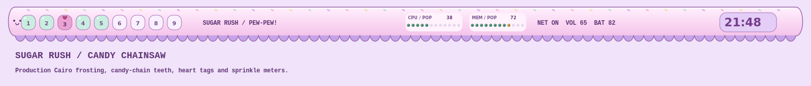

# Sugar Rush — Candy Chainsaw

A pastel chainsaw desktop inspired by the supplied illustration, preserved
unchanged in `wallpaper/sugar-rush.png`. Frosted pink, lavender, mint, and plum
carry across the full workspace. The dark plum text keeps the candy colors readable.



The detached 72-pixel bar is a frosted blade with scalloped lavender chain teeth,
rim sprinkles, and a tiny smiling face. The teeth are part of its Cairo silhouette;
the transparent gaps remain outside the input mask. Controls occupy the smooth
body above them. Candy-button workspace markers show a heart on the selected
workspace, mint for occupied tags, and pink urgency. Existing workspace mouse
bindings remain available.

CPU and memory use live twelve-dot sprinkle meters with percentages. The CPU
meter tracks utilization; memory uses the percentage of RAM in use. A lavender
clock capsule shows local 24-hour time. Network, volume, battery, tasklist,
tray, and layout controls retain their interactions. Geometry follows monitor
changes and DPI, with 12-pixel side insets, a 10-pixel top gap, and 12 pixels
between the bar and tiled windows.

Rounded windows, pink focus borders, frosted menus, notifications, terminals,
Rofi, tmux, Starship, btop, Neovim, and Python pads share the palette. The existing
switcher selects light GTK preference. Unfocused windows are 94% opaque; focused
ones remain solid. The wallpaper fills the desktop with aspect ratio preserved.

| Role | Color |
| --- | --- |
| Marshmallow background | `#fff1fb` |
| Lavender surface | `#f4e3fa` |
| Plum text | `#603575` |
| Berry focus | `#a33c83` |
| Mint status | `#45836b` |
| Pink alert | `#b74c85` |

Activate with `theme-toggle sugar-rush`; aliases: `sugar`, `candy`, `pew-pew`.
Installation leaves the active theme unchanged.

```sh
python -m unittest discover -s tests -p test_sugar_rush.py
lua5.3 tools/preview_sugar_rush.lua
```

The preview uses the production Cairo renderers with representative widget
placement. It is not a live desktop screenshot.
