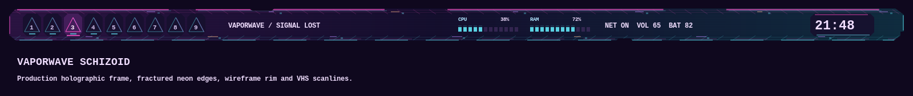

# Vaporwave Schizoid — Signal Lost

The supplied Glitched Neon Pyramid at Twilight artwork is preserved unchanged in
`wallpaper/vaporwave-schizoid.png`.




A detached 64-pixel glass bar blends deep violet into midnight blue. Fractured
cyan and hot pink edges, offset color traces, wireframe rim lines, and displaced
pixel tiles echo the dissolving pyramid. Faint VHS scanlines stay static between
redraws. The dark central lane keeps text readable. The frame scales with DPI;
its clipped corners and edge notches remain outside the input mask.

Numbered pyramid workspace buttons retain the normal mouse bindings, highlight
the selected workspace in pink, and mark occupied tags in cyan. Live CPU and RAM
meters use cyan blocks with pink high-range accents. The clock updates across
midnight. Existing tasklist, network, volume, battery, tray, and layout controls
retain their interactions.

The bar uses 12-pixel side insets, a 10-pixel top gap, and 12 pixels of clearance
above tiled windows. Window borders, notifications, menus, terminal palettes,
Rofi, Neovim, btop, tmux, Starship, and Python pads share the violet, pink, cyan,
and sunset-peach palette. Unfocused windows use 87% opacity; focused windows
remain solid.

| Role | Color |
| --- | --- |
| Midnight background | `#110c27` |
| Violet surface | `#21163f` |
| Pale lavender text | `#f0ddff` |
| Hot pink focus | `#ff55c8` |
| Electric cyan status | `#61e5f5` |
| Sunset peach warning | `#ffba8c` |

Select `theme-toggle vaporwave-schizoid` after deployment. Aliases: `vaporwave`,
`schizoid`, and `neon-pyramid`.

```sh
python -m unittest discover -s tests -p test_vaporwave.py
lua5.3 tools/preview_vaporwave.lua
```

The preview uses production Cairo rendering with representative widget placement,
not a live desktop screenshot. Tests cover rendering at multiple scales, meter
limits, tag updates, the clock's midnight transition, and isolated theme switching.
